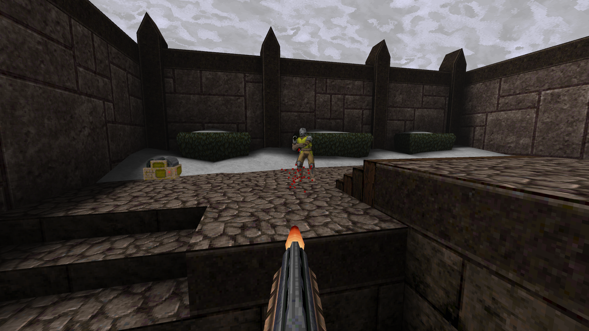

# Live Quake

Bots play Quake deathmatch live on your Omarchy desktop, and as your screensaver, until you click in and take over.



When a workspace is empty, the desktop background *is* Quake: FrikBot X bots fighting a deathmatch, live. Opening a
window pauses the game behind it. Click the game and you take over the bot you were watching, from exactly where it
was; **F12** hands it back. When the screen idles, the same game becomes your screensaver. Right-click the desktop for
a settings menu that looks like Quake's own options screen, drawn from your own game files. Single player, where one
bot plays the campaign, is the other mode.

It's useless and it's fun as hell. It's the Quake sibling of [Live Doom](https://github.com/slogonomo/live-doom).

> **Early release.** Live Quake runs every day on one Omarchy desktop (NVIDIA, with the Steam re-release), and was
> tested on private test compositors and in throwaway `HOME` folders. Read [What works today](#what-works-today)
> before anything else.

## What works today

Verified on a private labwc compositor with free LibreQuake data, unless an item says otherwise. The bots were
checked by recording the real engine in private sessions, mostly with id's Quake data, and watching the clips. Where a
test stands in for part of a real Omarchy desktop, it says so:

- **Deathmatch, the default:** FrikBot X bots fight in timed rounds on id's deathmatch maps from your own Quake data
  and on LibreQuake's free arenas, and the camera follows the action. Private real-GPU runs on the re-release's dm2
  and dm3, rotating to LibreQuake's lqdm1, covered repeated takeovers and F12 handbacks, including handback while
  dead. See [Deathmatch](#deathmatch-the-default).
- **Live background:** the real engine, Ironwail, renders on your GPU.
  - A production daemon watches Hyprland's outputs, workspaces and windows. Opening a window pauses the world exactly,
    with no game time passing.
  - The automated tests feed the observer **synthetic Hyprland data**. On a real desktop it reads the live session.
- **Take over:** a real click hands you the same game in the same process. Mouse look, keyboard, the game's own Esc
  menu and F12 back to the bot all work. You get the bot's exact position, view, health, armour,
  weapons and ammo, and F12 hands the same state back; both were checked in private clips. Keys and power-ups are
  copied too; keys were checked in a private native probe, while power-up transfers have not been clip-tested.
  In single player, weapons and keys disappear when collected, a human death restarts the level, and Quake's own Esc
  menu and console pause the world during takeover. Native Esc-menu Save, restart/load and New Game followed by F12
  were tested privately in single player; see [The OpenGL engine](#opengl-engine).
- **Settings menu:** a **right-click on the live background opens it** over the game, which stays paused until you
  close the menu. Opened from the app launcher (Live Quake in Apps), it's a floating window instead, which pauses
  only the desktop it's on, like any window. Either way a change reaches the controller at once. The menu is
  summoned through `omarchy-shell shell summon`, tested end to end against a **private stand-in** for Omarchy's shell.
- **Setup guide:** on a fresh install, a short guide opens once by itself. Tested offscreen only, against a stand-in
  for the controller; see [Setup guide](#setup-guide).
- **Theme background:** "Use with this theme" adds a Live Quake background to your theme and selects it, which turns
  the live background on, and "Remove" archives it again. It never picks Live Doom's background as a replacement.
  Tested in a private `HOME` only.
- **Screensaver:** input dismisses it and never steers the game; lock, display sleep and "unavailable" all pause it.
  - It's **off until you turn it on**. On a fresh install the setup guide offers it ticked, and applies it only when
    you press Finish; Skip leaves it off. Enabling it claims Omarchy's shared suppression entry only after the game
    and viewer are ready. Manual pause, an open menu, human play, loading, recovery, lock, sleep or unavailable
    observations release our verified entry so stock can handle the next idle cycle. Normal input dismissal keeps a
    healthy claim.
  - Foreign entries, including user-created empty toggles, are preserved. Removal or replacement of our entry disables
    the preference; enable it again to retry. Three failed presentations also disable it.
  - A missing presentation acknowledgement releases promptly and reserves the next complete idle cycle for stock.
    Live Quake never launches stock itself. The failed current cycle may have no saver until Omarchy's existing lock
    deadline. Private idle/GPU probes model the three-second grace; it hasn't been accepted on a real desktop yet.
  - A participating monitor entering standby ends the saver on all monitors.
- **Checkpoint (single player):** a new engine process restores the exact player position, health and map. One private
  test on e1m1 saved just after a takeover. Loading it in the same process and in a new one restored the same position
  and inventory, and handing back brought back exactly one bot. A checkpoint taken while FrikBot itself plays hasn't
  been tested privately. Deathmatch keeps no checkpoints.
- **Multiple monitors:** landscape and portrait outputs, resizing, and an output removed and re-added all keep one
  engine and one player. Tested with two virtual outputs.
- **Sound:** game sound goes to your system audio output through ALSA, which on Omarchy reaches PipeWire. By default
  it plays while you play, and stays off for the live background and the screensaver; you can change both in the menu.
  The menu's Sound section has an Output row that says whether sound is reaching the system, and why not if it isn't.
  On a real desktop the output reported ready, but the screen was locked at the time, so playback on real speakers
  isn't verified yet. If something forces PipeWire's quantum to 2048 or more (not the default), sound can crackle. No
  music decoder is compiled in.
- **Installer:** installs, updates, recovers and uninstalls with a dry-run, consent, and an ownership inventory. It has
  been verified in private `HOME` folders, and it made one install on a real desktop; see
  [Install, update and removal](#install-update-and-removal).
- **Switching games:**
  - Live Quake reads your Steam libraries, without changing them, only when you choose "Find Steam games", once when
    you reach the setup guide's game step, and at startup to recheck a Steam game you chose.
  - "Play" switches to a compatible Quake there, played in place from Steam's folder, and keeps where each game was.
  - A failed switch rolls back exactly to the game you had.
  - Your choice is remembered. After a restart, Live Quake spends at most five seconds checking that the game is
    still there and playable, then resumes it; otherwise it starts LibreQuake, keeps your choice for next time,
    and the menu says why.
  - Tested with free LibreQuake files arranged like a Steam install, and privately with real Steam files (the
    original game and the re-release), read only. In single player, FrikBot has run on the original game's e1m1 to
    e1m4 and e2m1, and the re-release's e1m1 to e1m3, in private clips. One save, made after a takeover, restored the
    same position and inventory. The mission packs play single player only and don't get FrikBot, so the player just
    stands still there; the one *Dissolution of Eternity* save carried across predates FrikBot.
- **OpenGL engine:** Ironwail renders on your GPU and hands frames to the desktop without copying them. It's the only
  engine; see [The OpenGL engine](#opengl-engine).

Not yet:

- **More of the real desktop:** beyond the first live tests on one desktop, the real idle cycle, sound on real
  speakers, the new menu's look there and the setup guide (tested offscreen only) are unverified.
- **The live screensaver on a real desktop:** not yet accepted there; it stays off until you turn it on.
- **Deathmatch bots in water:** they can still get stuck, especially on maps without saved routes.
  See [Deathmatch](#deathmatch-the-default).
- **A bot that finishes levels:** in single player FrikBot is still being tuned. It plays in bursts, spends about half
  its time stuck or looping, and hasn't reached a level's exit by itself in any clip: every level change so far is a
  forced skip. See [Single player](#single-player).
- **The 2021 re-release:** supported, with the limits described below. Before FrikBot, the engine started its first
  map and saved and reloaded it exactly in a private test. FrikBot replaces the re-release's own game code with the
  original's. In two private single-player clips on the re-release's data (e1m1 to e1m3) it passes on mechanics and
  plays as on the original data; saves and later maps are untested. See [docs/steam-games.md](docs/steam-games.md).
- **The Quake shareware episode:** not offered. id's shareware licence forbids modified games and public display, and
  FrikBot is a modified game, so it can't use shareware data ([docs/free-data.md](docs/free-data.md)).

## Deathmatch (the default)

The bots are **FrikBot X 0.10.2**, a classic Quake bot by Ryan "FrikaC" Smith, written in QuakeC, the game's own
scripting language. One game pack, built on your machine, holds FrikBot with our changes to how it picks goals, turns
and gets unstuck, id's GPL QuakeC v1.01 with small session changes, and our session code. It replaces the game's own
code for the original game, the re-release and LibreQuake. See [Credits](#credits) and [Licences](#licences).

- **Rounds:** four bots fight, and a round lasts 6 minutes or until someone reaches 25 frags. Quake then shows the
  rankings and moves to a random map from the rotation, never the same one twice in a row when more than one map is
  on. The menu's Game section
  sets the round time (3 to 20 minutes), the frag limit (off, 15, 25 or 50) and the number of bots (1 to 7). Changes
  to these, the skill and the maps apply from the next round. Nightmare bots fight as Hard.
- **Maps:**
  - id's deathmatch maps, from your own Quake data;
  - LibreQuake's arenas, lqdm1 to lqdm13, which the installer builds from the pinned LibreQuake `full.zip`. They're
    in the rotation with Quake from Steam too;
  - the maps of episodes 1 to 4, on id's registered data. They're off by default, and play as arenas, without
    monsters and with their exits closed.

  The Maps row turns them on and off; one map always stays on.
- **The camera** follows a bot that's fighting or on the move, and switches away from one that's idle, staring at a
  wall or stuck in water. "Now tracking", followed by the bot's name, shows at each switch (unless Hide chatter is
  on).
- **Take over:** click the game to take over the bot you're watching. Its frags become yours, and your row on the
  scoreboard reads "You". F12 hands the bot back, even while you're dead.
- **Hide chatter** (in View and controls) hides the notify lines (chat, kills and pickups) while a bot is shown.
  Centre messages and the rankings stay.
- **No checkpoints:** deathmatch keeps none, and switching between deathmatch and single player restarts the game.
  Mission packs play single player only, with no bot.

**Known limit:** bots can get stuck in water on maps without waypoints. FrikBot X brings its own waypoints for the
original game's dm1 to dm6 (not used on the 2021 re-release, whose maps differ). Live Quake includes its own
generated routes for lqdm1-5, lqdm7-9 and lqdm11-13. The saved graphs for lqdm6 and lqdm10 did not improve the
private comparisons, so those maps keep dynamic waypointing. The camera moves away from a bot that stays stuck.

## Single player

Choose Single player in the Game section's Mode row. One bot plays the campaign, and you take over from exactly where
it is.

How it runs:
- **The game runs in co-op internally.** The bot is a second player, and your own player is a hidden camera that
  follows it. A click swaps the two exactly, and F12 swaps them back. Item pickups follow single-player rules.
  A bot death keeps the map state and its keys and weapons; a human death restarts the level with the entry loadout.
- **The bot leaves the `start` hub automatically,** keeping inventory and the current skill. Episode finales lead
  to the next episode; a cold start or other return leads to e1m1. Human New Game stays on the hub until handback.
  This rule applies only to id1 maps with FrikBot; it leaves LibreQuake and mission packs alone.
- **Routes:** it follows hand-made routes (waypoints) on id's `start` and `end` maps and every level of episodes 1
  to 4 except e1m8; they're included in `third_party/` (see [Credits](#credits)). On LibreQuake's campaign maps it
  finds its own way.
- **When it stops making progress,** Live Quake has it re-plan and try a manoeuvre (or swim for dry land), and in the
  end skips the level: Live Quake triggers the level's exit for the bot, wherever it is, and Quake shows its own
  intermission and moves on. That screen may say COMPLETED for a level the bot skipped.
- **A slower watchdog backs that up:** after a minute without reaching new ground the bot re-plans, after three
  minutes without new ground the level restarts, and after fifteen minutes of bot play on one level, across deaths and
  restarts, it moves on. Human play, pauses and the settings menu don't count, and a death on its own triggers nothing.
- **Mission packs** don't get the bot, so the player just stands still there.

How well it plays, judged by watching private 240-second clips that run from e1m1 to e1m3 with takeovers and
handbacks, built with the waypoint bundle, against a human run that finishes e1m1 in 39 seconds:
- **The mechanics work.** There's one bot and the camera always stays on it, takeover and handback are exact, and
  there are no black frames and no cut-and-return view jumps. The COMPLETED screens show the map's own intermission
  view.
- **It plays in bursts:** fights, a secret, lifts. About half the time is dead time, stuck or looping.
- **It hasn't reached an exit by itself in any clip.** Its level changes are forced skips after about 30 seconds
  without progress, never in a level's first 90 seconds unless the bot is in water. Quake shows its stock COMPLETED
  screen for them.
- **It's weaker on LibreQuake's campaign maps,** which have no waypoints.
- **It plays the same on the 2021 re-release** (e1m1 to e1m3).

## Requirements

- Omarchy (Hyprland with the Quickshell shell) on x86_64.
- **A GPU whose driver supports GBM and dmabuf import.** Ironwail renders there and hands each frame to the desktop as
  a dmabuf. There's no software fallback: without that support the game stays off and the menu offers "Retry OpenGL".
  Tested on NVIDIA only.
- Build tools for the one-time native build:
  `omarchy pkg add base-devel git wayland libxkbcommon cairo pkgconf alsa-lib mesa libglvnd sdl2-compat`. They were all
  already present on the machine this was built on.
- The bot is built on your machine by `scripts/build-frikbot-local.py`, from our QuakeC in `src/quakec/`, FrikBot X
  0.10.2 and the episode waypoints (both included in `third_party/`), and two Git checkouts you fetch yourself. No
  script downloads them:
  - a Git checkout of `https://github.com/id-Software/Quake-Tools` at
    `c0d1b91c74eb654365ac7755bc837e497caaca73`, using id's GPL QuakeC v1.01 in `qcc/v101qc`;
  - a Git checkout of `https://github.com/fte-team/fteqw` at `f937b9d88f71fc4429db5fe56c6a98d922711b2e`, for its
    QuakeC compiler.
- About 500 MB in the build folder (`$work` below) for the engine sources, the build, the free LibreQuake data (the
  download is 111 MB) and the bot pack. You can delete it once the install has finished: the installed engine and data
  live in `~/.cache/live-quake` and `~/.local/share/live-quake`, never in the plugin folder.

## Using it

These controls, apart from Weapons and Scores, are exercised in the private tests, and the live background and the
settings menu have been used on a real desktop. Weapons and Scores use the game's own default key bindings.

| | |
|---|---|
| Take over | Left-click the game on an empty desktop (in deathmatch, you take the bot you're watching) |
| Move | W A S D (↑/↓ also move, ←/→ turn) |
| Look | Mouse |
| Run | Shift |
| Fire | Left mouse button or Left Ctrl |
| Jump | Space (Quake has no "use" key: doors and buttons open when you touch or shoot them) |
| Weapons | 1 to 8 |
| Scores | Hold Tab |
| Game menu | Esc |
| Back to the bot | F12 |
| Settings | Right-click the live background, or open Live Quake from the app launcher (a floating window) |

Until you finish or skip it, the setup guide shows in place of these sections; see [Setup guide](#setup-guide).
The settings menu has these sections:
- **Sound:** game sound while you play, while the bot plays and in the screensaver.
- **Live background:** whether it's on (this follows your background), whether it shows on empty desktops or all
  desktops, "Use with this theme" / "Remove from this theme", and "Slipgate theme" when our theme is installed but
  not in use.
- **Live screensaver:** on or off; off until you turn it on here or finish the setup guide with it ticked. Ownership
  or repeated presentation failures require an explicit retry.
- **View and controls:** the renderer in use (read-only, with "Retry OpenGL" after repeated failures), blur when
  paused, mouse speed, invert mouse and Hide chatter.
- **Game:** Mode (Deathmatch or Single player; changing it restarts the game), skill and, in deathmatch, Round time,
  Frag limit, Bots and Maps; then which game is playing, "Find Steam games", "Play" for each compatible game found,
  "Reroute bot", and "Get Quake on Steam" when none is found.

The Maps row opens a Deathmatch maps page with one row per group: id deathmatch, LibreQuake arenas, and Episode 1 to
4 maps (on id's registered data). Enter opens a group and lists its maps, each with its own switch; Back or Esc
returns to the settings.

When the menu reports a problem with "see logs", the details, which can include file paths, are kept out of the menu.
They go to the daemon's log: `journalctl --user -u live-quake` when it runs as the user service.

Live Quake also logs why it shows, pauses or hides the game, on change only and without window titles or paths. To see whether the game ever kept running on a desktop that had a window open:

```sh
journalctl --user -u live-quake LQ_COVERED_RUNNING=1
```

`journalctl --user -u live-quake SYSLOG_IDENTIFIER=live-quake-policy` shows every such record: per output, what was shown (`LQ_VIEW`), why (`LQ_REASON`), and whether the engine had confirmed it was paused (`LQ_ACK_PAUSED`).

## Setup guide

On a fresh install, a short setup guide opens by itself, just once, in a floating window after Live Quake's service
starts. An upgrade never opens it by itself; it shows in place of the settings the next time you open the menu.
Until you finish or skip it, opening Live Quake from Apps shows it.

It has up to four steps:
1. **Live background:** add it to your current theme, use the Slipgate theme (only when it's on offer; see
   [Slipgate theme](#slipgate-theme)), or skip it.
2. **Choose your Quake:** LibreQuake, "Find Steam games" or the Steam store. This step shows only while no playable
   Quake from Steam has been found. It looks in Steam once when you reach it, and a game you choose here switches at
   once.
3. **Live screensaver:** on or off. It starts ticked on a fresh install; an upgrade starts from your setting.
4. **Your setup:** a summary, which also offers "Quake from Steam" if one was found while LibreQuake is playing.

Apart from choosing a game (in the game step, or with the summary's "Quake from Steam"), nothing is applied until
you press **Finish**, which applies your choices in order and stops at the first failure with the reason. **Skip
setup** closes the guide for good and changes nothing. Back undoes nothing. If you close the menu part way, the guide
picks up where you left off. Its place is kept in `onboarding.json` (see
[Install, update and removal](#install-update-and-removal)).

## Slipgate theme

Slipgate is an Omarchy theme made for Live Quake, in gunmetal, rust, slime and rune gold, with every colour starting
from Quake's own palette. Its first background is a Live Quake live background. Choosing it from Live Quake also
turns the live background on.

It isn't published yet. Until it is, and Live Quake is updated with its address, the setup guide and the menu's
"Slipgate theme" row offer it only when it's already installed (in `~/.config/omarchy/themes/slipgate`) and not in
use. Choosing it runs Omarchy's own `omarchy-theme-set slipgate`. That's the one place Live Quake changes your theme,
and only when you ask; the installer never does.

## Games

- **LibreQuake** is the default. It's a free, BSD-licensed replacement for Quake's data, so Live Quake works
  without owning Quake, with no consent step. It runs with the bot's game code instead of its own. Its deathmatch
  arenas come from the same download, and the bot has no hand-made routes for its maps.
- **Quake from Steam:** "Find Steam games" looks in your Steam libraries and checks the files in place, and "Play"
  switches to a compatible game.
  - The game data is never copied or changed. The menu does keep menu pictures and sounds drawn from it in its art
    cache.
  - The original 1996 game and the 2021 re-release run with FrikBot, in deathmatch on their own deathmatch maps plus
    LibreQuake's arenas. Private single-player clips cover e1m1–e1m3 in the re-release and several original maps.
    Mission-pack data is recognized, but mission packs play single player only, with no FrikBot pack and no ambient
    bot on OpenGL.
- **The Quake shareware episode** isn't offered. id's shareware licence forbids modified games and public display.
  FrikBot is a modified game, so it can't use shareware data ([docs/free-data.md](docs/free-data.md)).

## Install, update and removal

> **Tested on one real desktop.** The installer has been verified in private, throwaway `HOME` folders with real
> build artifacts, and on one real desktop from a local checkout with `--private-copy`. The marketplace steps below
> were run end to end in a throwaway `HOME`, with `omarchy plugin add` done as the plain clone it is; they haven't run
> on a real desktop yet.

### Install from the marketplace

`omarchy plugin add` only clones Live Quake into `~/.config/omarchy/plugins/io.github.slogonomo.live-quake`. Live
Quake builds its engine and bot on your machine, so it needs a one-time manual setup after that. If any of the build
tools are missing, `omarchy pkg add` asks for your password to install them, so run it in a terminal. Run one command
at a time. The install line prints its exact plan and asks `Apply exactly this file plan? [y/N]`: read the plan and
type `y`.

```sh
omarchy plugin add https://github.com/slogonomo/live-quake
cd ~/.config/omarchy/plugins/io.github.slogonomo.live-quake
omarchy pkg add base-devel git wayland libxkbcommon cairo pkgconf alsa-lib mesa libglvnd sdl2-compat
work=$(mktemp -d /tmp/live-quake-build.XXXXXX)
python3 -B scripts/bootstrap-ironwail.py --work-dir "$work" --fetch-sources
python3 -B scripts/bootstrap.py --work-dir "$work" --fetch-data
inputs=$(mktemp -d)
git clone https://github.com/id-Software/Quake-Tools "$inputs/quake-tools" \
  && git -C "$inputs/quake-tools" checkout --detach c0d1b91c74eb654365ac7755bc837e497caaca73 \
  && git clone https://github.com/fte-team/fteqw "$inputs/fteqw" \
  && git -C "$inputs/fteqw" checkout --detach f937b9d88f71fc4429db5fe56c6a98d922711b2e \
  && python3 -B scripts/build-frikbot-local.py --base "$inputs/quake-tools" --compiler-source "$inputs/fteqw" --output "$work/bot"
python3 -B scripts/build-ironwail.py --work-dir "$work" --frikbot-pack "$work/bot/frikbot-local.pak" --frikbot-receipt "$work/bot/frikbot-build.json"
/usr/bin/python3 -E -s -B scripts/install.py --home "$HOME" install --source "$PWD" --build "$work" --archive "$work/librequake-full.zip"
omarchy plugin enable io.github.slogonomo.live-quake
systemctl --user daemon-reload
systemctl --user enable --now live-quake.service
```

- The `git clone` chain fetches the bot's two inputs from [Requirements](#requirements) at their pinned commits, and
  builds the bot only if both checkouts succeed.
- The installer reads the plugin folder and never changes it, so `omarchy plugin update` can pull new versions. The
  menu runs from the plugin folder's `menu/`.
- Everything else (what the downloads are, what the installer writes, the last three lines) is as in
  [Install from a local checkout](#install-from-a-local-checkout).
- `$inputs` and `$work` can be deleted once the install has finished.

### Install from a local checkout

This is for working on Live Quake. It builds everything on your machine from a checkout of this repository, and
copies the plugin into `~/.config/omarchy/plugins/io.github.slogonomo.live-quake` (`--private-copy`).

1. **If you installed an earlier version,** update it as in [Update](#update), or remove it first with the
   uninstaller in [Remove](#remove). The uninstaller keeps your settings and saves; to start completely fresh, setup
   guide included, also delete the folders listed under "At runtime Live Quake also uses" below.
2. **Have the two bot inputs** from [Requirements](#requirements), and point these at them: `LOCAL_QUAKEC` (the
   Quake-Tools checkout) and `LOCAL_FTEQW` (the FTEQW checkout).
3. **Build and install,** one line at a time, from the root of your checkout. The install line prints its exact plan
   and asks `Apply exactly this file plan? [y/N]`: read the plan and type `y`. It takes that answer only from a
   terminal, never from a pipe.

```sh
work=$(mktemp -d /tmp/live-quake-build.XXXXXX)
python3 -B scripts/bootstrap-ironwail.py --work-dir "$work" --fetch-sources
python3 -B scripts/bootstrap.py --work-dir "$work" --fetch-data
python3 -B scripts/build-frikbot-local.py --base "$LOCAL_QUAKEC" --compiler-source "$LOCAL_FTEQW" --output "$work/bot"
python3 -B scripts/build-ironwail.py --work-dir "$work" --frikbot-pack "$work/bot/frikbot-local.pak" --frikbot-receipt "$work/bot/frikbot-build.json"
/usr/bin/python3 -E -s -B scripts/install.py --home "$HOME" install --source "$PWD" --build "$work" --archive "$work/librequake-full.zip" --private-copy --dry-run
/usr/bin/python3 -E -s -B scripts/install.py --home "$HOME" install --source "$PWD" --build "$work" --archive "$work/librequake-full.zip" --private-copy
omarchy plugin enable io.github.slogonomo.live-quake
systemctl --user daemon-reload
systemctl --user enable --now live-quake.service
```

- The scripts download only with the explicit `--fetch-sources` or `--fetch-data` flags. They fetch Ironwail's
  source and its libretro ABI header at pinned full Git commits, and LibreQuake 0.09-beta's `full.zip`, checked
  against a pinned length and SHA-256.
- If you already have a verified bot pack and its build receipt from an earlier build, you can skip the
  `build-frikbot-local.py` line and pass those two files to `build-ironwail.py` instead.
- `omarchy plugin enable` turns on the settings menu in Omarchy's shell.
- The last two lines start Live Quake now and at every login. Leave them out to start it yourself.
- After it starts, the [setup guide](#setup-guide) opens once.
- The `$work` folder can be deleted once the install has finished; the installer copied what it needs.

How the installer behaves:
- **`--dry-run`** prints the exact plan and changes nothing.
- **Changing anything** needs `--yes`, or typing `y` at the plan.
  - A `--yes` run prints its own plan and applies it, and that plan is re-checked just before it runs.
  - A separate `--dry-run` earlier isn't bound to it, so if anything changed in between, read the `--yes` run's plan
    too.
- **It reads the plugin checkout** but never changes it.
- **It copies** the verified engine, viewer and core (the locally built bot pack, checked
  against its build receipt) into your cache, and the free LibreQuake data into your data folder.
- **It writes** a systemd user unit and an app-launcher entry, without enabling or starting anything. The launcher
  entry shows up in the app launcher straight away. The installer doesn't check or change whether the service is
  running; on an update, a unit you enabled stays enabled.
- **It records** every file it creates, with hashes, in an ownership inventory. Shared parent folders aren't recorded,
  and `~/.local/share/live-quake` and `~/.cache/live-quake` themselves stay after uninstall.

### Update

From your local checkout, after pulling the new code: rebuild into a fresh `$work` with the build lines above, then
run, one line at a time:

```sh
systemctl --user stop live-quake.service               # only if you run it
/usr/bin/python3 -E -s -B scripts/install.py --home "$HOME" install --source "$PWD" --build "$work" --archive "$work/librequake-full.zip" --private-copy --dry-run
/usr/bin/python3 -E -s -B scripts/install.py --home "$HOME" install --source "$PWD" --build "$work" --archive "$work/librequake-full.zip" --private-copy
systemctl --user daemon-reload                         # if the plan said the unit changed
systemctl --user start live-quake.service              # only if you run it
```

The installer copies the menu into its own `impl-<sha256>/` folder in the plugin and points the manifest there, so a
changed menu gets a new address and Omarchy's shell, which reloads the plugin when its files change, loads it without
a restart. An unchanged menu keeps its folder, and the replaced one is removed. After an update that changed the menu,
the installer asks the running shell which menu it loaded; if it still has the old one, it says so in one line, and
`omarchy restart shell` loads the new one. It never restarts the shell itself.

The installer refuses the whole update if any file it owns has been changed, or if a file it would write already
exists and isn't its own.

**From the marketplace:** stop Live Quake, pull the new version, rebuild, then install again without
`--private-copy`. For the rebuild, run the lines from `work=` through `build-ironwail.py` in
[Install from the marketplace](#install-from-the-marketplace).

```sh
systemctl --user stop live-quake.service               # only if you run it
omarchy plugin update io.github.slogonomo.live-quake
cd ~/.config/omarchy/plugins/io.github.slogonomo.live-quake
# rebuild here: the lines from work= through build-ironwail.py
/usr/bin/python3 -E -s -B scripts/install.py --home "$HOME" install --source "$PWD" --build "$work" --archive "$work/librequake-full.zip"
systemctl --user daemon-reload                         # if the plan said the unit changed
systemctl --user start live-quake.service              # only if you run it
omarchy restart shell                                  # loads the new menu
```

A marketplace install runs the menu from the plugin folder itself, so Omarchy's shell keeps the old menu until it
restarts.

**If an install or update was interrupted:** nothing is changed automatically. Run
`… scripts/install.py --home "$HOME" recover --dry-run`, then `--yes`. Every staged file, backup and target is
checked by hash, mode and inode. If recover finds changes it can't account for, it writes nothing and asks for manual
inspection.

> **Known limitation.** An interruption at an unlucky moment while files are being staged (closing the terminal, for
> example) can leave a partly written staging file. `recover` then reports `staged bytes or identity changed` or
> `unexpected staging contents` and refuses, and install and uninstall stay blocked. Your installed files and Live
> Doom are untouched. The fix today is manual: delete the hidden `.install-*` folders under the plugin folder,
> `~/.cache/live-quake` and `~/.local/share/live-quake`, then run `recover` again. A staging folder the installer
> never journaled can also stay behind without being reported, including in `~/.config/systemd/user` and
> `~/.local/share/applications`. If an install ends with "Installation committed; final durability check was
> interrupted", the new files are in place: run `recover --dry-run`, then `--yes`. `recover` keeps and lists any
> installed file you changed in the meantime. It refuses a file that holds an older installed version until you edit
> or remove that file.

### Remove

```sh
systemctl --user disable --now live-quake.service      # only if you enabled it
omarchy plugin disable io.github.slogonomo.live-quake  # if it is enabled
/usr/bin/python3 -E -s -B ~/.config/omarchy/plugins/io.github.slogonomo.live-quake/scripts/install.py --home "$HOME" --runtime-dir "$XDG_RUNTIME_DIR" uninstall --dry-run
/usr/bin/python3 -E -s -B ~/.config/omarchy/plugins/io.github.slogonomo.live-quake/scripts/install.py --home "$HOME" --runtime-dir "$XDG_RUNTIME_DIR" uninstall --yes
```

How removal behaves:
- The uninstaller refuses while the service is enabled or the plugin is on.
- It checks whether Live Quake is running only when you pass `--runtime-dir "$XDG_RUNTIME_DIR"`, as shown above. It
  takes no paths from the environment.
- It is file-only, so it can't prove the service has stopped. Its report marks service retirement as a manual step.
- It removes only files it installed that are unchanged.
- It keeps anything you edited, plus your settings, saves, setup-guide progress and theme background. It reports what
  it kept.
- For a local install it removes the plugin copy too. For a marketplace install, run
  `omarchy plugin remove io.github.slogonomo.live-quake` after it.

An interrupted screensaver claim can be recovered after stopping Live Quake. Run the installed helper with the same
explicit HOME, state and runtime directories used by the daemon:

```sh
/usr/bin/python3 -E -s -B ~/.config/omarchy/plugins/io.github.slogonomo.live-quake/src/idle_cleanup.py --home "$HOME" --state-dir "${XDG_STATE_HOME:-$HOME/.local/state}/live-quake" --runtime-dir "$XDG_RUNTIME_DIR/live-quake"
```

Stop cleanup removes a recorded token only when its bytes and full recorded identity still match. If the entry still
contains our token, touching it, changing permissions, adding a hard link or replacing its inode preserves the entry
and journal. A provably foreign entry is left untouched and only our obsolete journal is retired. A complete pending
claim with a matching published journal retires only the pending record when the remaining ownership is safe; the
unchanged claim can then be released normally. A complete pending claim without a journal can retire its matching token.

The helper can create and hold a missing runtime lock after reboot. A `safe: false` result preserves installation
files and foreign or uncertain ownership entries; an already verified release may have completed, as reported by
`released`. Do not delete the shared Omarchy toggle by hand. For an unsafe result:

1. Keep Live Quake stopped, using the service and plugin retirement steps above.
2. Inspect `idle-claim-pending.json` and `idle-ownership.json` in Live Quake's state directory, and `screensaver-off`
   in Omarchy's toggles directory. Check each entry's type, owner, mode, size and link count. Complete authority records
   must be private regular files with mode 0600 and one link; the token is 64 bytes. Compare token bytes privately
   without copying them into logs. A stray `.live-quake-idle-*` alias can explain a two-link pending token.
3. Turn Omarchy's screensaver back on in its menu, then rerun the helper. This is the user-facing way to remove the
   shared suppression entry; Live Quake never removes an unsafe token or its aliases itself.
4. If the helper still reports unsafe, preserve the installation and authority records and request ownership recovery
   with the path-free result. Incomplete records, unsafe permissions, extra hard links or conflicting token records
   need manual review; the helper cannot infer authority from them.

Uninstall checks its plan again while holding the runtime lock, before changing ownership. It can remove the
installation while preserving a safely recognized, touched private suppression entry and its journal; its report says
those entries were preserved, and the stock screensaver remains suppressed.
Turn Omarchy's screensaver back on in its menu if you want it.
Unsafe or unrecognized records still block uninstall. Explicitly enabling the saver can archive a bad recovery record
and, once presentation is ready, adopt a safe matching token and inode without deleting or rewriting the shared entry.
It cannot take a foreign entry.
While the menu, loading or runtime warmup blocks presentation, adoption waits and the shared entry stays unchanged.
Editing it again during that wait cancels adoption and disables the preference.
A restart during that wait also cancels the in-memory adoption request. Enable the saver again once the runtime is
ready; no shared entry was changed by the interrupted request.

**What it installs:**

| Path | What |
|---|---|
| `~/.config/omarchy/plugins/io.github.slogonomo.live-quake/` | The plugin copy (`--private-copy`): the allowlisted plugin files, with the menu in its own `impl-<sha256>/` folder |
| `~/.config/systemd/user/live-quake.service` | The daemon's user unit, written but never enabled or started by the installer; it has a start limit |
| `~/.local/share/applications/live-quake.desktop` | The app-launcher entry that opens the settings menu |
| `~/.cache/live-quake/build/` | `quake-engine`, `quake-viewer` and the engine core, hash-pinned: `ironwail/Quake/ironwail_libretro.so` and the local bot pack `ironwail/frikbot/pak0.pak`; `ironwail/frikbot/dm-maps.pak`, LibreQuake's lqdm deathmatch maps from the pinned `full.zip` |
| `~/.local/share/live-quake/librequake/full/id1/` | `pak0.pak`, `pak1.pak` and LibreQuake's `docs/` |
| `~/.local/share/live-quake/build-provenance.json`, `installation.json` | What was built and installed, with hashes |

It never touches Live Doom's files, Omarchy's `shell.json`, your theme, other plugins or the plugin checkout. Foreign
or unowned Omarchy toggles are preserved; uninstall can retire a verified Live Quake suppression entry. In testing,
the installer refused every layout of Live Doom files planted in tricky places.

**At runtime Live Quake also uses:**
- `~/.local/state/live-quake/` for settings (`config.json`), the setup guide's place (`onboarding.json`), checkpoints
  (under `ironwail-v2-default/` and `profiles/`) and background records;
- `~/.cache/live-quake/menu-art/` for the menu art cache;
- `$XDG_RUNTIME_DIR/live-quake/`, mode `0700`;
- the `1-live-quake.webp` marker, if you choose "Use with this theme" (Remove archives it). The Slipgate theme brings
  its own Live Quake background.

The uninstaller keeps those, so delete them yourself for a full purge. Each game's checkpoint is tied to its
installed files, so uninstalling and reinstalling (or restoring the free data from a backup) starts LibreQuake fresh.

## OpenGL engine

Ironwail is the only engine. It renders on your GPU and hands each frame to the viewer as a dmabuf, without copying
it. The installer and the daemon need a complete, source-verified Ironwail build and a local bot pack before they
write anything.

- **While the bot plays,** the view uses flat lightstyles (no flickering lights) and a softer power-up tint. Taking
  over restores your own settings.
- **A desktop covered by a window** freezes on a copy of Quake's own last frame, blurred to your setting.
- **GPU start-up, checkpoint loading and renderer retry** are all bounded. After repeated failures the game stays off
  until you choose "Retry OpenGL" in the menu.
- **Proved privately in single player:** the game's own Esc-menu Save and New Game, a checkpoint saved after a
  takeover reloading exactly, F12 handback, and the intermission view.
- **There's no software fallback.** Isolated test captures may render with software OpenGL (llvmpipe), which runs the
  same Ironwail renderer and bot.

## Privacy

Live Quake makes no network requests except the explicit `--fetch-…` downloads above. It sends nothing anywhere.
It reads your Steam library metadata and game files in place, only when you choose "Find Steam games", reach the
setup guide's game step, or start Live Quake with a Steam game chosen, to list what you can play and check your
choice. File paths stay on your machine and never appear in the menu. If
you play a Steam game, the menu's art cache (`~/.cache/live-quake/menu-art`) keeps menu pictures and sounds drawn
from it. Once the Slipgate theme is published and Live Quake is updated with its address, choosing to install it from
the setup guide or the menu has Omarchy download it from GitHub.

## Credits

- **FrikBot X** by Ryan "FrikaC" Smith: the bots, still playing Quake twenty years on.
- **The episode waypoints** (`start`, `end` and e1m1 to e4m8 except e1m8): routes by [bta].monster, as the files say
  (e1m7 by `/\/\O/\/sT3rTU`). They came in the FrikBot X package, whose notes point to a winxp76.net collection.
  Thanks to Jason Brownlee for preserving Quake bot history in the [Quake Bot Archive](https://github.com/Jason2Brownlee/QuakeBotArchive), which would otherwise disappear.
- **LibreQuake**, for free maps, art and sounds, and its lqdm arenas.
- **Ironwail** by Andrei Drexler, and id Software for Quake and its GPL source.

## Licences

- Our own code is [0BSD](LICENSE), and our own art is CC0-1.0.
- The Ironwail patch and adapter (`patches/ironwail-desktop.patch`, `src/ironwail/`), the stuck-level exit parser
  (`src/level_bypass.h`), our QuakeC (`src/quakec/`) and the bot build script, which carries splices of id's QuakeC
  (`scripts/build-frikbot-local.py`), are GPL-2.0-or-later. The libretro ABI header, `libretro.h`,
  is MIT.
- An engine built from them is distributed under **GPL-2.0**. Most Ironwail files are "version 2 or
  later", but some carry no header and fall under their GPLv2 text.
- Ironwail's bundled `ironwail.pak` holds id-derived art and settings, so it is never installed or loaded.
- `preview.png` and our other screenshots show LibreQuake art under
  [BSD-3-Clause](LICENSES/BSD-3-Clause-LibreQuake.txt). Development captures of id's Quake art, from the developer's
  own copy, are private evidence, never in the release export, and not covered by our licences.
- No base game assets are included. LibreQuake is downloaded by you and keeps its own licences: BSD-3-Clause for its art and
  sounds, and GPL-2.0-or-later for its QuakeC and `progs.dat`.
- The bot pack is built on your machine from FrikBot X 0.10.2 (public domain, included with its notice in
  `third_party/frikbot-x/` and [LICENSES/LicenseRef-FrikBot-X.txt](LICENSES/LicenseRef-FrikBot-X.txt)), id's GPL
  QuakeC v1.01, our QuakeC and the episode waypoints in `third_party/quake-bot-archive/`, included unchanged (see
  [Credits](#credits)).
- Our generated LibreQuake deathmatch routes in `src/waypoints/` are 0BSD and ship in the DM-maps pack.
  They contain no third-party waypoint data; the underlying maps retain their BSD-3-Clause credits.

Details are in [THIRD-PARTY-NOTICES.md](THIRD-PARTY-NOTICES.md).

Live Quake is a hobby project, provided as-is without warranty (see [LICENSE](LICENSE)). Use it at your own risk.

Quake is a trademark of ZeniMax Media Inc., an affiliate of id Software. Live Quake is not affiliated with or
endorsed by id Software, ZeniMax, Bethesda, Nightdive Studios, Valve or the LibreQuake project.
