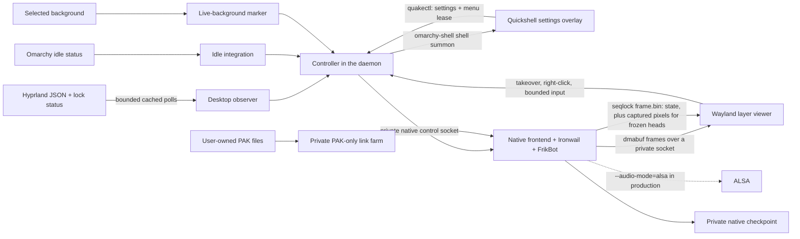

# Architecture

One engine and one local player persist across bot, human, menu and saver ownership.

> **Proof boundary.** The unit tests use fakes for the GPU, the compositor and the engine. The GPU tests run the real
> engine, viewer and controller on the real GPU, inside a private nested labwc with virtual outputs and no host bus,
> audio or input devices. Desktop observations come from fixtures and synthetic Hyprland data; the Omarchy shell is a
> private stand-in, and the idle cycle is a fake first-party status. Separately, one real Omarchy desktop has run it
> since 2026-10-11, installed with the installer below. Each section below names its own limits.

## Frames: GPU transport and the native bridge

**Frames go straight from the GPU to the compositor.** Ironwail renders with EGL into GBM buffers and the frontend
passes each one to the viewer as a dmabuf, over a private `SOCK_SEQPACKET` socket (`src/gpu_transport.h`). The viewer
imports it with `zwp_linux_dmabuf_v1`, attaches it to a subsurface and returns it when the compositor releases it. No
pixel is copied on the CPU per frame. The controller opens the render node and hands the frontend and viewer their
descriptors; both refuse to start without them.

**A frozen head shows a captured frame.** When a window covers an output, or the game pauses, the viewer asks for one
capture: the engine renders a zero-tic frame, reads it back once into the bridge below, and the viewer copies it into
shared memory, blurs it to the user's setting and keeps showing that.

**The native bridge,** `frame.bin`, is `src/bridge.h`: a 4096-byte header followed by bounded XRGB8888 storage.
- The frontend publishes the header every frame, and pixels only for an explicit capture.
- The writer increments an atomic sequence counter (with a release fence) around each publication. Readers accept a
  copy only when the counter is even and unchanged.
- The ordering is verified on x86-64; portability to weakly ordered CPUs is not claimed.
- The Quake magic is distinct from Live Doom's.
- Readers reject links, non-regular files, unexpected ownership, a wrong size and invalid geometry.
- Frame storage is preallocated before mapping, so exhausted storage fails during setup, not mid-frame.

The header carries:
- process identity, ownership and map;
- health, armour, weapons and ammunition;
- position in thousandths of a world unit, and yaw in thousandths of a degree;
- simulation time;
- bot telemetry: new-ground cells, stuck events and the current goal;
- `console_visible`, and the capture fields for a frozen head.

`tic` counts native host frames, including load and menu frames; `leveltime` measures simulation time.

The native control socket accepts a small, enumerated vocabulary: pause, bot ownership, key, mouse, audio gate, skill,
save, load (and `load-preserve`), checkpoint commit and discard (`commit-session`, `discard-session`), `present`,
replan, capture, map restart and skip, the human view size, status, audio status and shutdown, plus `dm-config` (the
deathmatch maps and rules for the next round), `hide-chatter` and `match-state`. Deathmatch refuses `load`. Requests,
connections and deadlines are all bounded.

Startup, checkpoint load and bot handback redraw the world before publishing a bot frame. The redraw runs inside a
native error guard with zero frame time, and it does not advance the simulation. Bot frames with a visible console are
rejected, so native save paths never reach the live background.

**Audio.** The production daemon starts the frontend with `--audio-mode=alsa`. Tests and probes keep the default,
which discards PCM.
- With ALSA it writes non-blocking through bounded buffers, at the core's real sample rate.
- The controller reports `runtime.audio` (output, state and a path-free reason), and the menu shows it as an Output
  row. If the device can't be opened, the game keeps running silently and the state reads `unavailable`.
- The gate drops queued audio at once on pause, load and ownership changes.
- The `sound.*` settings still gate it.
- Tested privately only into a null sink inside an isolated namespace (no `/dev/snd`, host `/run` hidden, whole ALSA
  config replaced). On a real desktop the output reports ready.
- alsa-lib is a dynamically linked system library (LGPL-2.1-or-later).

## Daemon, controller and ownership

**The daemon.** `src/daemon.py` is the production daemon and the CLI behind `scripts/quakectl`. It handles:
- the XDG paths: an owned `0700` `XDG_RUNTIME_DIR`, and freedesktop defaults for empty values;
- a private singleton lock, with recovery from a stale lock after SIGKILL;
- the core-dump guard;
- a graceful SIGTERM and SIGHUP stop that tears down every child;
- crash backoff with a persistent quick-failure history.

**Policy.** `src/policy.py` is pure policy. Empty, awake outputs let the bot run, and a busy output keeps a frozen
live background. The game is suspended by:
- unknown observations;
- a lock;
- sleeping displays;
- a settings pause lease;
- a manual pause.

The default screensaver owner is `unknown`.

**Controller and leases.** `src/controller.py` owns the engine, viewers, leases and settings.
- Opening the menu grants a six-second pause lease, renewed every two seconds, which renew can't recreate once
  closed.
- Human takeover needs an empty, focused output.
- Workspace changes, focus loss, busy or locked states, input-stream EOF, F12 and native Quit revoke ownership and
  release held keys.
- Settings use bounded nofollow reads and atomic writes.
- A fresh configuration starts with the live background and saver off, and the engine loads lazily.
- Turning the live background off checkpoints and unloads the engine.

**Desktop observer.** `src/desktop.py` polls Hyprland's existing monitors/clients JSON batch. Monitor
`solitaryBlockedBy` metadata supplies the session lock state: any `LOCK` wins; a readable monitor without the
early `WORKSPACE` blocker proves unlocked. A present `null` field also proves unlocked. Missing or malformed
metadata remains undetermined. Only that case
queries Omarchy's lock status, at most once per five seconds. The fallback expires independently after 3.5 seconds,
so a persistently undetermined desktop has safe unavailable gaps before the next attempt; new batches cannot renew
an old unlock result. During workspace-less transients a cached fallback can delay lock detection for up to
3.5 seconds; normal readable metadata keeps the existing desktop batch cadence.

- Every command runs by absolute path, under a core guard, in a closed environment, with a 0.6 s deadline and output
  caps. The whole process group is killed at the deadline.
- Results are cached, with a stale window longer than a slow but successful poll cycle.
- An output is busy when its active or special workspace has a mapped window. Named workspaces are handled per
  output.
- Bad or stale data fails closed: unavailable, lock unknown, saver owner unknown.
- **The automated observer tests use synthetic Hyprland data shaped like the real JSON.** The production daemon
  queries the user's live session.

**Idle and the screensaver.** `src/idle.py` and `src/idle_controller.py` read Omarchy's first-party idle status. The
saver maps as an exclusive overlay over the same running game; input dismisses it, and lock, activity or bad status
stop it.

- The idle worker is dormant while the preference is off, the desktop is unavailable or locked, or every output
  is asleep. It resumes when the desktop is unlocked with at least one awake output, at most one query per second.
  A freshness request wakes the existing worker for its next budgeted poll; it adds no query. A new claim or
  adoption requires a locally validated reply received within 0.5 seconds. Successful cache age still starts at the
  command start and expires after two seconds. Error grace runs through the next scheduled poll plus one second,
  capped at that same two-second deadline; failures never renew it. If the controller observes expiry before a
  retry completes, it stops and consumes the current cycle. Confirmed activity, lock and display sleep are applied
  without debounce.
  The query budget survives rapid preference toggles, and disabled-generation replies are discarded.
- Production permits claiming, with the saved preference off by default. A claim requires a restored clean game,
  acknowledged native policy, current viewer generation and configured awake heads. Pause, menu, takeover, loading,
  recovery, lock, sleep and stale observations release only the journal-verified entry. Normal dismissal consumes its
  cycle while keeping a healthy claim. Poll errors retain the last good idle observation only through its bounded
  deadline; a new claim requires a validated reply received at most 0.5 seconds ago. Confirmed activity, lock and
  sleep stop immediately. One participating monitor entering standby ends the saver on all heads.
- Each activation has a fixed two-second acknowledgement deadline. The viewer tags callbacks from committed Quake
  images by generation and cycle; configuration, focus, black parents and older wallpaper callbacks cannot acknowledge
  a saver. Reports require the live viewer's peer PID and every participating head. Feedback confirms compositor
  participation, not physical scanout. Missing feedback fails locally without restarting the engine or advancing its
  OpenGL recovery latch.
- Disabled viewers issue no saver control requests. Enabled viewers learn the opt-in generation through their existing
  view reply, then use nonblocking saver control exchanges. Only the callback belonging to a real committed Quake image
  can acknowledge a cycle; frozen SHM and transparent probes cannot acknowledge a GPU saver.
- Recovery persists the failed-cycle count and reserves the next complete idle cycle for stock, including across daemon
  restart. Three failed presentations disable the preference. Revoke and external suppression have sticky reasons;
  a recovery-record or save failure has the sticky `recovery-unavailable` reason until explicit re-enable resets it.
  foreign files and incomplete journals remain untouched. Live Quake never invokes the stock launcher: a failed current
  cycle can have no saver until Omarchy's existing lock deadline.
- Uninstall and an ignored-failure `ExecStopPost` share observer-free verified cleanup while holding the daemon runtime
  lock. The post-stop command has a one-second timeout and a 0.1-second kill grace. It also runs on service restart:
  release, then reclaim only when ready. The next deployment changes the unit and needs `daemon-reload`.
  Shutdown attempts exact-identity release before saving or waiting for children. Persistent token identity excludes
  mount-dependent device numbers. Stop cleanup requires matching token bytes and the full recorded identity; a touched,
  changed-permission, hard-linked or replaced entry holding our token keeps its journal and is not unlinked. A provably
  foreign entry stays untouched while its obsolete journal is retired. Explicit re-enable can adopt
  a safe matching token and inode only after readiness, updating the journal without changing the shared entry.
  It pins the current full identity at the explicit request; a later edit during warmup cancels adoption and disables
  the preference. Adoption waiting for readiness is in memory; a restart cancels that request and requires explicit
  re-enable. Settings expose only the additive `screensaver.adoption_available` boolean, never that identity.
  Uninstall rechecks its inventory and plan inside the runtime lock before ownership mutation. Recognizing a safely
  touched token permits installation removal only while preserving that token and journal with a fixed note; it never
  grants deletion authority. Unsafe entries holding our token and unreadable authority records remain blocked.
  Complete pending claims resolve under both locks, including one bounded in-process retry after publication failure.
  When the published journal matches and remaining ownership is safe, resolution keeps the token and journal and removes
  only the pending record; without a journal, its matching created token can be retired. Incomplete,
  hard-linked or unsafe-permission records remain untouched and need manual recovery. After reboot, cleanup creates and
  acquires a missing runtime lock before mutation. The lock helper imports no controller or desktop code.
  Manual recovery inspects record type, owner, mode, size, links and matching token bytes privately, then uses Omarchy's
  own menu to turn its stock saver back on before repeating cleanup. Uncertain authority records remain for review.
  If the whole runtime parent is absent after logout and no ownership record exists, uninstall relies on its existing
  manual service-retirement prerequisite; it does not report a held runtime lock. A recorded claim stays blocked until
  an explicit available private runtime can exclude a controller.
- Private probes use first-party status fixtures, private HOME and real image callbacks. Installed Omarchy and pinned
  Hyprland sources indicate layer mapping does not resume idle, so an unrecognized layer survives the three-second grace
  while the idle monitor remains idle. That source inference and the private behaviour have not yet been confirmed on
  a real desktop.

**Menu launcher.** A right-click on the live background (the viewer sends `settings <output>`) and `quakectl open-menu`
summon the overlay through `/usr/bin/omarchy-shell shell summon`.
- The pause lease is taken before the call and restored if it fails.
- Summoning requires the plugin to be installed, with a 2 s deadline and a 16 KiB cap.
- It never falls back to a second keyboard grab.
- Verified end to end against a private stand-in for the Omarchy shell.

**Live-background marker.** `src/background.py` adds `assets/live-quake.webp` to the current theme's personal
backgrounds as `1-live-quake.webp`. A selected background whose name contains `live-quake` turns the live background on.
- Ownership is journalled, and Remove archives only unchanged images that Live Quake recorded.
- A replacement background never comes from another live marker, Live Doom's included.
- Verified in a private `HOME` only.

**Monitors.** Two outputs share one engine and one player: one can be covered and frozen while the other stays live,
and an output can be removed and re-added, or resized. That was verified on the real GPU with two virtual outputs on
the private compositor. Live background and saver views use a centred, aspect-preserving cover crop.

**Game catalogue.** The controller owns a game catalogue.
- `scan-steam` runs one bounded background scan of Steam libraries on request; the only automatic scan is the
  start-up restore below.
- `use-game` switches synchronously. It checkpoints the current game, rolls back exactly on failure, and keeps a
  separate checkpoint profile per package.
- The selected package id is saved with the settings. At start-up, before any engine launches, one bounded attempt
  (five seconds for the Steam scan plus validation) restores it through the same validation as `use-game`; on any
  failure the controller starts LibreQuake, keeps the saved choice for the next start and sets a fixed
  `selection_note`. That attempt is the only automatic scan.
- Switching is tested with free data arranged like a Steam install in a private `HOME`. Play on real Steam data has
  been checked only in private runs: early campaign maps and a few deathmatch maps.

**Deathmatch** is the default mode; mission packs, and packages without deathmatch maps, run single player.
- The controller starts the engine with the enabled maps, round time, frag limit and bot count. `dm-config` changes
  them for the next round, and a mode change restarts the engine. Deathmatch writes and loads no checkpoints.
- At each map load the engine picks the next map at random from the list, never the current one
  (`src/ironwail/dm_rotation.h`). The installed `dm-maps.pak` adds LibreQuake's lqdm arenas to every non-expansion
  package. Episode maps join only when enabled, and play without monsters and with exits closed.
- The session QuakeC tops the bots up to the configured count. The hidden human client follows one bot, chosen four
  times a second by a director (`src/ironwail/dm_director.h`) that prefers fights and recent events and leaves bots
  that are idle, facing a wall or stuck in water.
- Takeover is pinned to the followed bot. Its frags move with the body, the scoreboard shows the human's row as "You",
  and F12 hands back even while the human is dead.

The menu talks to the backend only through `quakectl`; `menu/README.md` lists the commands it uses.

## Install and release

**Installer.** `scripts/install.py` installs from a verified source and build into an explicit `HOME`.
- It copies an allowlisted, symlink-free plugin tree.
- It writes a systemd user unit and an app-launcher entry, and never enables or starts the unit. On an update it
  leaves the service's state as it is, without checking it.
- It records an ownership inventory, and supports update, rollback and an uninstall that preserves changed files.
- It has dry-run, explicit consent and a crash-recovery journal with an explicit `recover`.
  - An interruption while staging can still leave state that `recover` refuses. Clearing it is manual. A failure
    after the final commit keeps the new files, and `recover` reports any later user changes rather than refusing.
- It has run in private fixture `HOME` folders and made one install on a real desktop.

**Release export.** `scripts/export-release.py` builds the local release tree from a fixed allowlist. It leaves out
the development-only parts: tests, evidence, design captures, internal notes and the private paths.

**The checkout.** It stays free of game archives, symlinks, vendor trees and build output.
- `scripts/bootstrap-ironwail.py` fetches Ironwail and the libretro ABI header at pinned full commits, refusing a
  symlinked or foreign source checkout.
- `scripts/bootstrap.py` fetches only the free data, checking its length and SHA-256 before extracting into an
  explicitly chosen private directory.
- `scripts/build-frikbot-local.py` builds the local bot pack from pinned, locally supplied inputs and writes a receipt.
- `scripts/build-ironwail.py` accepts only the pinned revision plus the exact pinned patch and overlays, and records
  source and binary hashes; `scripts/build.py` holds its shared private-output helpers.
  Its development-only `--diagnostic` mode builds the offscreen capture core with `LIVE_QUAKE_GPU=0` in a separate
  work directory. It stages `lq_egl_offscreen.c` from the development checkout and builds no frontend or viewer.
  The normal gate checks the command/overlay selection with a mocked builder; real diagnostic compilation and bot
  behaviour checks are private, opt-in runs.
